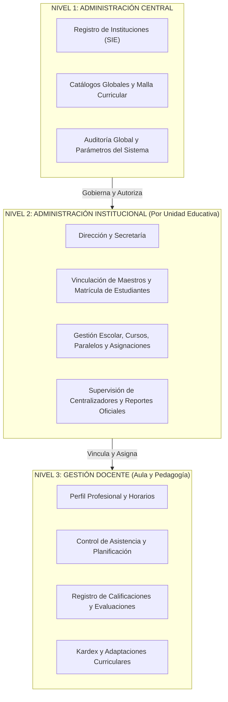

<!--
SYNC IMPACT REPORT
==================
Proyecto: Sistema Integral de Registro y Gestión de Maestros
Metodología: Spec-Driven Development (SDD)
País: Estado Plurinacional de Bolivia
Versión: 1.1.0 (Ratificada — Fuente de Verdad Oficial)
Documento Principal: specs/constitution.md

Sincronización de Decisiones Estratégicas:
  - DECISIÓN 001: Alcance Multiinstitucional (Tenants independientes por Unidad Educativa).
  - DECISIÓN 002: Gestión Integral (Área A: Profesional de Maestros; Área B: Académica Escolar).
  - DECISIÓN 003: Administración Central (Supervisión global multi-tenant y catálogos SEP).
  - DECISIÓN 004: Identidad Docente Centralizada (Persona y Maestro únicos; vinculaciones locales).
  - DECISIÓN 005: Arquitectura Multi-Tenant (PostgreSQL compartido con RLS y contexto backend).
  - Principios de Aislamiento 1 a 10 incorporados y vinculantes.
  - Modelo de 16 Entidades Conceptuales formalizado.
  - Stack Aprobado: Monolito Modular con NestJS + Next.js + PostgreSQL/Prisma + Docker.
  - Matriz RBAC Contextual de 7 Roles.
  - 10 Criterios de Aceptación Arquitectónica (DoD).
  - 3 Decisiones Técnicas Pendientes identificadas explícitamente.
-->

# SISTEMA INTEGRAL DE REGISTRO Y GESTIÓN DE MAESTROS
## PROJECT CONSTITUTION (V1.1.0 — RATIFICADA)

**Metodología:** Spec-Driven Development (SDD)  
**Versión:** 1.1.0  
**Ámbito Geográfico y Normativo:** Estado Plurinacional de Bolivia  
**Estado:** Decisiones estratégicas confirmadas y ratificadas  
**Autoridad:** Fuente de Verdad Oficial del Proyecto (`specs/constitution.md`)

---

## 1. DECISIONES ESTRATÉGICAS APROBADAS (REQUISITOS FUNDAMENTALES)

Las siguientes decisiones estratégicas constituyen mandatos arquitectónicos no negociables:

### DECISIÓN 001 — Alcance Multiinstitucional
La plataforma administrará múltiples unidades educativas del Subsistema de Educación Regular y Alternativa desde una única aplicación web centralizada. Cada unidad educativa dispondrá de un espacio institucional independiente (*tenant*), con aislamiento de sus usuarios, docentes vinculados, estudiantes matriculados, gestiones escolares, asignaciones académicas, centralizadores y registros disciplinarios.

### DECISIÓN 002 — Gestión Integral (Dos Grandes Áreas Funcionales)
El sistema articulará dos macro-dominios interdependientes:
- **A. Gestión Profesional de Maestros:**
  - Expediente profesional y hoja de vida docente.
  - Información biográfica y datos personales verificados.
  - Registro de formación académica, títulos y postgrados.
  - Especialidades y áreas de conocimiento según RDA.
  - Repositorio documental digitalizado de respaldo (títulos, certificados, memorándums).
  - Historial cronológico de vinculaciones institucionales y años de servicio.
  - Estado del docente (activo, permiso, comisión, pasivo).
- **B. Gestión Académica e Institucional:**
  - Padrón y expediente escolar de estudiantes con vinculación de tutores.
  - Estructura de cursos, grados y paralelos por nivel y turno.
  - Asignaciones académicas docentes por materia y paralelo.
  - Control de asistencia diaria y justificaciones.
  - Planificación curricular periódica y adaptaciones curriculares especiales.
  - Instrumentos de evaluación diagnóstica, continua y trimestral/bimestral.
  - Registro de calificaciones cuantitativas y cualitativas (dimensiones Ser, Saber, Hacer, Decidir).
  - Centralizadores consolidados de notas y generación de boletines oficiales.
  - Horarios escolares por curso y por docente.
  - Kardex disciplinario y actas de entrevistas con padres de familia.
  - Informes estadísticos y pedagógicos institucionales.

### DECISIÓN 003 — Administración Central
Existirá un nivel de administración general de la plataforma con atribuciones para habilitar unidades educativas, supervisar catálogos curriculares globales, parametrizar la plataforma, auditar la seguridad y consultar reportes estadísticos consolidados autorizados.

### DECISIÓN 004 — Identidad Docente Centralizada
Un maestro podrá prestar servicios en una o varias unidades educativas simultáneamente. Su identidad profesional y registro biográfico serán únicos y globales en la plataforma. Sin embargo, sus vinculaciones administrativas y sus asignaciones curriculares serán estrictamente locales e independientes para cada institución.

### DECISIÓN 005 — Arquitectura Multi-Tenant con PostgreSQL y RLS
El sistema adoptará una arquitectura multi-tenant sobre una base de datos PostgreSQL compartida con aislamiento lógico riguroso por institución. La seguridad y separación de datos se garantizará en profundidad mediante validación contextual en backend (NestJS) y políticas de seguridad a nivel de fila (**PostgreSQL Row Level Security - RLS**).

---

## 2. ARQUITECTURA INSTITUCIONAL (TRES NIVELES DE RESPONSABILIDAD)



### Nivel 1. Administración Central
- Registrar, habilitar y suspender unidades educativas (asociadas a su código SIE).
- Administrar parámetros globales del sistema y calendarios base.
- Gestionar administradores institucionales y credenciales maestras.
- Administrar catálogos del Sistema Educativo Plurinacional (áreas curriculares, especialidades, tipos de evaluación).
- Supervisar indicadores analíticos y reportes demográficos/académicos consolidados.
- Monitorear registros de auditoría y trazas de seguridad globales.

### Nivel 2. Administración Institucional (Unidad Educativa)
- Administrar información institucional del colegio (código SIE, turnos, dirección, directiva).
- Registrar la vinculación formal de maestros y la matriculación de estudiantes.
- Configurar gestiones escolares activas, cursos, paralelos y malla curricular local.
- Asignar cargas horarias y materias a los maestros vinculados.
- Supervisar el avance curricular, cumplimiento de asistencia y cierre de notas trimestrales.
- Generar y firmar centralizadores generales, libretas de calificaciones y reportes institucionales.

### Nivel 3. Gestión Docente
- Consultar expediente profesional y hoja de vida.
- Visualizar asignaciones académicas, horarios y lista oficial de estudiantes por curso/paralelo.
- Registrar la asistencia diaria de los educandos.
- Programar evaluaciones y asentar calificaciones según las dimensiones del modelo educativo.
- Elaborar planificaciones curriculares de clase y registrar adaptaciones curriculares.
- Registrar incidencias en kardex estudiantil y actas de entrevistas.
- Emitir informes pedagógicos de rendimiento escolar.

---

## 3. PRINCIPIOS DE AISLAMIENTO DE INFORMACIÓN (NO NEGOCIABLES)

1. **Pertenencia Institucional Obligatoria:** Todo registro con alcance institucional debe portar la columna `institution_id` de forma mandatoria, con índice y clave foránea íntegra.
2. **Acceso Exclusivo al Tenant:** Los usuarios institucionales (directores, secretarios, maestros) solo pueden consultar, crear o modificar información asociada a su institución activa.
3. **Validación Contextual en Backend:** El backend (NestJS) resolverá el contexto institucional a partir del token JWT autenticado y la sesión activa; queda terminantemente prohibido delegar la autorización a un parámetro enviado desde el cliente.
4. **No Confianza en el Frontend:** El envío de un `institution_id` por parámetros de ruta, cuerpo o query no otorga privilegios ni se asume verídico sin validación en los guards de seguridad.
5. **PostgreSQL Row Level Security (RLS):** Toda tabla con datos multi-tenant debe tener habilitada la directiva `ENABLE ROW LEVEL SECURITY` y políticas `FORCE ROW LEVEL SECURITY` para aislar consultas incluso ante fallos lógicos del ORM.
6. **Seguridad Homóloga en Archivos Digitales:** Los expedientes en PDF, fotografías y certificados almacenados en almacenamiento de objetos (S3/MinIO) requieren URLs prefirmadas de corta duración validadas contra la pertenencia institucional.
7. **Privilegio Central Auditado:** Las consultas que agreguen datos entre múltiples colegios están reservadas estrictamente a roles de Nivel 1 y generarán traza de auditoría obligatoria.
8. **Transacciones Interinstitucionales Explícitas:** El traspaso de un estudiante o la vinculación de un docente a un nuevo colegio debe ejecutarse como una transacción explícita con consentimiento y registro auditable.
9. **Independencia de Registros Académicos:** La identidad global de un maestro no le otorga visibilidad sobre las notas de otra unidad educativa en la que también trabaje. Sus vistas académicas están encapsuladas en la institución activa.
10. **Trazabilidad e Inmutabilidad de Información Crítica:** Prohibida la eliminación destructiva (*hard-delete*) en registros de notas, asistencias, expedientes y usuarios; se implementará borrado lógico (*soft-delete*) y bitácora de auditoría inmutable.

---

## 4. MODELO DE DATOS Y SEPARACIÓN DE ENTIDADES

Para evitar duplicidades y garantizar la integridad referencial, el modelo de datos formalizará la separación estricta de las siguientes entidades conceptuales:

```
[ Persona ] 1 ──── 1 [ Usuario ]
    │ 1
    ├─── N [ Maestro ] 1 ──── N [ Vinculación Institucional ] N ──── 1 [ Unidad Educativa ]
    │                                    │ 1                                      │ 1
    └─── N [ Estudiante ]                └─── N [ Asignación Académica ]           └─── N [ Gestión Escolar ]
              │ 1                                  │ 1                                       │ 1
              └─── N [ Inscripción ]               │                                         ├─── N [ Periodo ]
                        │ 1                        │                                         └─── N [ Curso / Paralelo ]
                        └─── N [ Calificación / Asistencia ] ◄───────────────────────────────────────┘
```

### Definición de Entidades Principales
1. **Persona:** Datos biográficos universales (Cédula de Identidad, complemento, nombres, primer apellido, segundo apellido, fecha de nacimiento, género, dirección, teléfono, correo).
2. **Usuario:** Cuenta de acceso al sistema (username/email, password hash Argon2, estado activo/bloqueado, 2FA opcional) con vínculo 1:1 a Persona.
3. **Maestro:** Perfil profesional del docente (Registro Docente Administrativo - RDA, nivel de formación, especialidad de egreso, postgrados, escalafón docente).
4. **Unidad Educativa:** Tenant institucional (Código SIE oficial, nombre formal, distrito educativo, departamento, turno, dependencia: fiscal/convenio/privada, dirección).
5. **Vinculación Institucional:** Contrato o memorándum de asignación del Maestro a una Unidad Educativa (fecha inicio, fecha conclusión, cargo: docente/director/secretario, estado: activo/inactivo).
6. **Gestión Escolar:** Año lectivo escolar (ej. Gestión 2026), calendario y estado (abierta/cerrada).
7. **Periodo de Evaluación:** Trimestres o bimestres dentro de una gestión escolar con fechas de inicio, fin y bloqueo de notas.
8. **Curso y Paralelo:** Grado académico (Inicial, Primaria, Secundaria) y paralelo asignado (A, B, C, D).
9. **Materia / Área Curricular:** Asignatura conforme a los planes y programas del Ministerio de Educación (Matemática, Lenguaje, Física, etc.).
10. **Asignación Académica:** La asignación concreta de un Maestro a una Materia en un Curso/Paralelo para una Gestión Escolar determinada.
11. **Estudiante:** Registro del educando con su código RUDE, vinculado a su Persona y tutores legales.
12. **Inscripción:** Matrícula oficial de un Estudiante en una Unidad Educativa, Curso y Paralelo para una Gestión Escolar.
13. **Evaluación:** Instrumento evaluativo programado por el docente para un periodo (Ser, Saber, Hacer, Decidir).
14. **Calificación:** Nota numérica (1-100) y apreciación cualitativa obtenida por el estudiante en una evaluación.
15. **Asistencia:** Registro de presencia (Presente, Falta, Licencia, Atraso) por estudiante y fecha.
16. **Auditoría:** Registro inmutable de eventos sensibles (actor, institución, tabla, ID de registro, valor anterior, valor nuevo, IP, timestamp).

---

## 5. PRINCIPIOS DE ARQUITECTURA Y STACK TECNOLÓGICO

La arquitectura del sistema será un **Monolito Modular** de alta cohesión, desacoplado internamente por dominios de negocio:

* **Frontend:** Next.js (App Router), React, TypeScript estricto, Tailwind CSS, componentes de interfaz accesibles y responsivos.
* **Backend:** NestJS estructurado en módulos de dominio (Auth, Institutions, Teachers, Academic, Evaluations, Attendance, Audit). Arquitectura inspirada en puertos y adaptadores.
* **Capa de Persistencia:** PostgreSQL 16+ con esquemas normalizados y políticas RLS habilitadas en todas las tablas transaccionales.
* **ORM y Acceso a Datos:** Prisma ORM como mapeador principal y generador de migraciones, con extensiones o transacciones en sesión para seteo del contexto RLS (`SET LOCAL app.current_institution_id = ...`).
* **Documentación y Contratos de API:** API REST documentada con OpenAPI 3.0 / Swagger, con validación de entradas mediante DTOs fuertemente tipados (`class-validator` y Zod).
* **Infraestructura y Contenedores:** Docker y Docker Compose para garantizar reproducibilidad exacta entre entornos de desarrollo, pruebas y producción local/self-hosted.

---

## 6. SEGURIDAD Y CONTROL DE ACCESO (RBAC CONTEXTUAL)

El acceso a los recursos se gobernará mediante un modelo **RBAC enriquecido con Contexto Institucional**:

### Matriz de Roles Oficial
1. **Superadministrador (Nivel 1):** Gestión técnica de la plataforma, despliegues, migraciones e inspección de logs.
2. **Administrador Central (Nivel 1):** Registro y supervisión de Unidades Educativas, configuración de catálogos curriculares nacionales y consulta de estadísticas globales.
3. **Administrador Institucional (Nivel 2):** Configuración de la Unidad Educativa, gestión de usuarios locales y apertura/cierre de gestiones escolares.
4. **Director (Nivel 2):** Máxima autoridad pedagógica de la institución; aprueba vinculaciones, supervisa notas, centralizadores y firma reportes oficiales.
5. **Secretario (Nivel 2):** Operador administrativo del colegio; registra inscripciones de estudiantes, vinculación de docentes y emite boletines.
6. **Maestro (Nivel 3):** Operador de aula; registra asistencias, calificaciones, planificaciones y evaluaciones exclusivamente para sus cursos asignados.
7. **Comisión Técnico-Pedagógica (Nivel 2/3):** Supervisión de rendimiento escolar, adaptaciones curriculares y seguimiento a estudiantes rezagados.

### Directiva de Autorización Contextual
El sistema evaluará cada petición HTTP mediante la 5-tupla:
$$\text{Autorización} = f(\text{Usuario}, \text{Rol}, \text{Institución\_Activa}, \text{Recurso}, \text{Operación})$$
Un maestro que ejerza como director en el Colegio "A" y como docente en el Colegio "B" cambiará su contexto institucional en el frontend mediante selector explícito, recibiendo permisos acordes a la institución seleccionada.

---

## 7. ALCANCE DEL PRODUCTO (17 MÓDULOS DEL MVP)

1. **Autenticación y Sesión:** Autenticación JWT, renovación de tokens, resolución y conmutación de contexto institucional.
2. **Gestión de Usuarios:** Creación y activación de cuentas, asignación de roles globales e institucionales.
3. **Gestión de Instituciones:** Alta y configuración de unidades educativas con código SIE y turnos.
4. **Roles y Permisos:** Motor de evaluación RBAC contextual en middleware y decoradores de NestJS.
5. **Registro de Maestros:** Expediente profesional, datos biográficos y especialidades RDA.
6. **Vinculaciones Institucionales:** Alta, baja y control del estado contractual de maestros por colegio.
7. **Gestión Académica:** Apertura y configuración de gestiones escolares anuales y periodos evaluativos.
8. **Gestión de Estudiantes:** Empadronamiento de alumnos con código RUDE y datos de tutores.
9. **Cursos y Paralelos:** Malla de grados y paralelos por nivel escolar.
10. **Asignaciones Docentes:** Matriz de asignación de maestros a materias y paralelos.
11. **Control de Asistencia:** Módulo de asistencia diaria, atrasos y justificaciones médicas.
12. **Configuración de Evaluaciones:** Parametrización de dimensiones evaluativas del modelo educativo boliviano.
13. **Registro de Calificaciones:** Planilla ágil de notas por periodo para el maestro.
14. **Centralizadores de Calificaciones:** Consolidado automático de notas por curso y paralelo.
15. **Reportes Básicos:** Boletines de calificaciones, listas de curso y libretas escolares en PDF.
16. **Auditoría del Sistema:** Registro inmutable de eventos sensibles y modificaciones de notas.
17. **Importación y Exportación:** Carga masiva de estudiantes y docentes en formato Excel/CSV y exportación de planillas oficiales.

---

## 8. CRITERIOS DE ACEPTACIÓN ARQUITECTÓNICA (DEFINITION OF DONE ARQUITECTÓNICA)

La arquitectura y la base de código se considerarán conformes a la Constitución únicamente si cumplen:
- **C1 (Multi-Tenancy):** Pruebas de integración automatizadas que verifiquen que dos instituciones no pueden consultar ni mutar registros cruzados, incluso alterando parámetros de cliente.
- **C2 (Aislamiento RLS):** Ejecución de consultas directas en PostgreSQL demostrando que las políticas RLS bloquean registros de tenants ajenos cuando el contexto no coincide.
- **C3 (Identidad Única de Docente):** Un maestro registrado una sola vez en el sistema puede asociarse a dos colegios distintos manteniendo expedientes académicos separados.
- **C4 (Independencia de Asignaciones):** Modificar la calificación o asignación de un docente en un colegio no tiene ningún efecto colateral en su perfil ni en otros colegios.
- **C5 (Historial Multigestión):** La apertura de una nueva gestión escolar preserva íntegramente los historiales de notas, centralizadores e inscripciones de gestiones pasadas.
- **C6 (RBAC Contextual):** Un usuario con roles diferenciados entre colegios ve actualizada su matriz de permisos inmediatamente al cambiar de contexto institucional.
- **C7 (Trazabilidad):** Toda modificación a una nota o vinculación genera automáticamente su registro en la tabla de auditoría con actor, fecha y valores previos.
- **C8 (Pipeline de Calidad):** Verificación técnica obligatoria de types (`strict`), linter, build y suite de pruebas en verde antes de fusionar cualquier cambio.
- **C9 (Contratos OpenAPI):** Todos los endpoints deben estar descritos y tipados bajo el estándar OpenAPI/Swagger.
- **C10 (Reproducibilidad Docker):** El sistema completo debe levantarse de forma determinista mediante `docker compose up`.

---

## 9. CONTROL DE CAMBIOS Y GOBERNANZA

- **Autoridad:** Esta Constitución prevalece sobre cualquier especificación técnica, preferencia de implementación o documentación externa.
- **Procedimiento de Enmienda:** Cualquier cambio debe proponerse como una enmienda formal motivada, registrarse en el *Amendment Log* y contar con la aprobación del líder del proyecto antes de modificar especificaciones dependientes.

### Amendment Log

| Fecha | Versión | Tipo | Descripción de la Enmienda |
| :--- | :--- | :--- | :--- |
| **2026-10-31** | **1.1.0** | **Ratificación Mayor** | Integración formal de la Adenda Oficial V1.1: Multi-tenancy con RLS en PostgreSQL, Arquitectura Institucional de 3 Niveles, Separación Maestro-Vinculación-Asignación, RBAC Contextual, Monolito Modular (NestJS/Next.js/Docker) y MVP de 17 módulos para el Estado Plurinacional de Bolivia. |
| 2026-10-31 | 1.0.0 | Creación inicial | Borrador inicial generado en el onboarding del arnés. |

---

## 10. DECISIONES PENDIENTES DE VALIDACIÓN TÉCNICA

Las siguientes decisiones técnicas complementarias quedan identificadas explícitamente para ser resueltas durante las fases de especificación técnica (`specify` y `plan`):

1. **Estrategia de enlace RLS con Prisma ORM:**
   - *Alternativa A:* Usar Prisma Client Extensions para inyectar automáticamente `SET LOCAL app.current_institution_id` en cada transacción interactiva.
   - *Alternativa B:* Complementar Prisma con un cliente de consultas SQL tipadas (p. ej. Kysely o `pg`) para las operaciones críticas bajo RLS.
   - *Estado:* Pendiente de prueba de concepto en la Fase de Especificación de Datos.
2. **Mecanismo de Conmutación de Contexto de Institución:**
   - *Alternativa A:* Un único token JWT con el `active_institution_id` en el payload, requiriendo reemisión de token al cambiar de institución.
   - *Alternativa B:* Un token de usuario general acompañado de un header HTTP `X-Institution-Context` validado contra la lista de vinculaciones activas en cada request.
   - *Estado:* Pendiente de especificación en el módulo de Autenticación.
3. **Formato Oficial de Exportación de Centralizadores:**
   - Definir si el formato de exportación de notas debe emular exactamente la plantilla del SIE/SIGED del Ministerio de Educación de Bolivia o si se utilizará un formato institucional configurable.
   - *Estado:* Pendiente de consulta funcional con los administradores educativos.

**Version**: 1.1.0 | **Ratified**: 2026-10-31 | **Last Amended**: 2026-10-31
