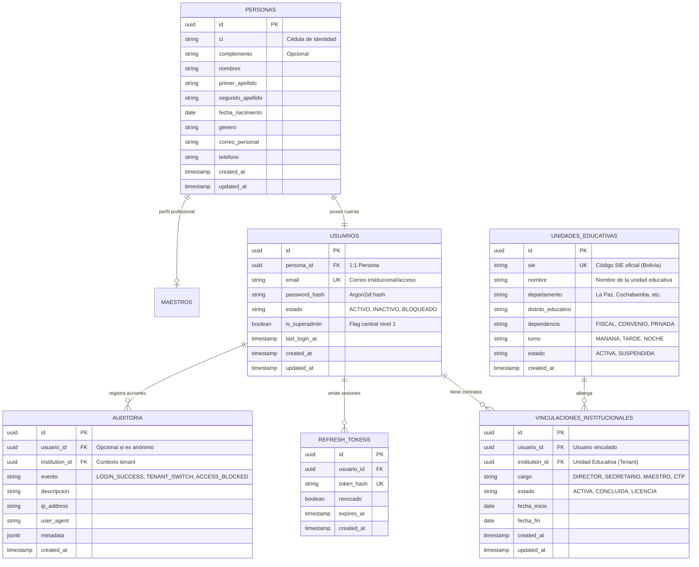

# Data Model & RLS Policies: 001-auth-multi-tenant
## Modelo de Datos y Políticas PostgreSQL RLS para Autenticación

**Feature:** `001-auth-multi-tenant`  
**Fecha:** 2026-10-31  
**Motor de Persistencia:** PostgreSQL 16+ con RLS forzado  
**ORM:** Prisma ORM  

---

## 1. Diagrama Entidad-Relación (Módulo de Autenticación)



---

## 2. Esquema DDL SQL y Políticas Row Level Security (RLS)

A continuación se define el script SQL canónico que ejecuta PostgreSQL durante las migraciones:

```sql
-- 1. Extensiones necesarias
CREATE EXTENSION IF NOT EXISTS "uuid-ossp";

-- 2. Configuración de variable de sesión para Tenant
-- Usada por las políticas: NULLIF(current_setting('app.current_institution_id', true), '')::uuid

-- 3. Tabla UNIDADES_EDUCATIVAS (Catálogo Institucional)
CREATE TABLE unidades_educativas (
    id UUID PRIMARY KEY DEFAULT uuid_generate_v4(),
    sie VARCHAR(20) NOT NULL UNIQUE,
    nombre VARCHAR(255) NOT NULL,
    departamento VARCHAR(50) NOT NULL,
    distrito_educativo VARCHAR(100) NOT NULL,
    dependencia VARCHAR(30) NOT NULL DEFAULT 'FISCAL',
    turno VARCHAR(30) NOT NULL DEFAULT 'MANANA',
    estado VARCHAR(30) NOT NULL DEFAULT 'ACTIVA',
    created_at TIMESTAMP WITH TIME ZONE DEFAULT CURRENT_TIMESTAMP,
    updated_at TIMESTAMP WITH TIME ZONE DEFAULT CURRENT_TIMESTAMP
);

-- 4. Tabla PERSONAS (Identidad Biográfica Universal)
CREATE TABLE personas (
    id UUID PRIMARY KEY DEFAULT uuid_generate_v4(),
    ci VARCHAR(20) NOT NULL,
    complemento VARCHAR(10),
    nombres VARCHAR(100) NOT NULL,
    primer_apellido VARCHAR(100) NOT NULL,
    segundo_apellido VARCHAR(100),
    fecha_nacimiento DATE NOT NULL,
    genero VARCHAR(10) NOT NULL,
    correo_personal VARCHAR(150),
    telefono VARCHAR(30),
    created_at TIMESTAMP WITH TIME ZONE DEFAULT CURRENT_TIMESTAMP,
    updated_at TIMESTAMP WITH TIME ZONE DEFAULT CURRENT_TIMESTAMP,
    CONSTRAINT uq_persona_ci UNIQUE (ci, complemento)
);

-- 5. Tabla USUARIOS (Credenciales de Acceso)
CREATE TABLE usuarios (
    id UUID PRIMARY KEY DEFAULT uuid_generate_v4(),
    persona_id UUID NOT NULL UNIQUE REFERENCES personas(id) ON DELETE RESTRICT,
    email VARCHAR(150) NOT NULL UNIQUE,
    password_hash VARCHAR(255) NOT NULL,
    estado VARCHAR(30) NOT NULL DEFAULT 'ACTIVO',
    is_superadmin BOOLEAN NOT NULL DEFAULT FALSE,
    last_login_at TIMESTAMP WITH TIME ZONE,
    created_at TIMESTAMP WITH TIME ZONE DEFAULT CURRENT_TIMESTAMP,
    updated_at TIMESTAMP WITH TIME ZONE DEFAULT CURRENT_TIMESTAMP
);

-- 6. Tabla VINCULACIONES_INSTITUCIONALES
CREATE TABLE vinculaciones_institucionales (
    id UUID PRIMARY KEY DEFAULT uuid_generate_v4(),
    usuario_id UUID NOT NULL REFERENCES usuarios(id) ON DELETE CASCADE,
    institution_id UUID NOT NULL REFERENCES unidades_educativas(id) ON DELETE RESTRICT,
    cargo VARCHAR(50) NOT NULL,
    estado VARCHAR(30) NOT NULL DEFAULT 'ACTIVA',
    fecha_inicio DATE NOT NULL DEFAULT CURRENT_DATE,
    fecha_fin DATE,
    created_at TIMESTAMP WITH TIME ZONE DEFAULT CURRENT_TIMESTAMP,
    updated_at TIMESTAMP WITH TIME ZONE DEFAULT CURRENT_TIMESTAMP,
    CONSTRAINT uq_usuario_institucion_cargo UNIQUE (usuario_id, institution_id, cargo)
);

CREATE INDEX idx_vinculacion_usuario ON vinculaciones_institucionales(usuario_id);
CREATE INDEX idx_vinculacion_institucion ON vinculaciones_institucionales(institution_id);
CREATE INDEX idx_vinculacion_estado ON vinculaciones_institucionales(usuario_id, institution_id, estado);

-- 7. Tabla REFRESH_TOKENS
CREATE TABLE refresh_tokens (
    id UUID PRIMARY KEY DEFAULT uuid_generate_v4(),
    usuario_id UUID NOT NULL REFERENCES usuarios(id) ON DELETE CASCADE,
    token_hash VARCHAR(255) NOT NULL UNIQUE,
    revocado BOOLEAN NOT NULL DEFAULT FALSE,
    expires_at TIMESTAMP WITH TIME ZONE NOT NULL,
    created_at TIMESTAMP WITH TIME ZONE DEFAULT CURRENT_TIMESTAMP
);

-- 8. Tabla AUDITORIA
CREATE TABLE auditoria (
    id UUID PRIMARY KEY DEFAULT uuid_generate_v4(),
    usuario_id UUID REFERENCES usuarios(id) ON DELETE SET NULL,
    institution_id UUID REFERENCES unidades_educativas(id) ON DELETE SET NULL,
    evento VARCHAR(100) NOT NULL,
    descripcion TEXT,
    ip_address VARCHAR(50),
    user_agent TEXT,
    metadata JSONB,
    created_at TIMESTAMP WITH TIME ZONE DEFAULT CURRENT_TIMESTAMP
);

CREATE INDEX idx_auditoria_institucion ON auditoria(institution_id, created_at DESC);
CREATE INDEX idx_auditoria_usuario ON auditoria(usuario_id, created_at DESC);

-- ============================================================================
-- ACTIVACIÓN Y POLÍTICAS DE ROW LEVEL SECURITY (RLS)
-- ============================================================================

-- Habilitar y forzar RLS en tablas institucionales
ALTER TABLE vinculaciones_institucionales ENABLE ROW LEVEL SECURITY;
ALTER TABLE vinculaciones_institucionales FORCE ROW LEVEL SECURITY;

ALTER TABLE auditoria ENABLE ROW LEVEL SECURITY;
ALTER TABLE auditoria FORCE ROW LEVEL SECURITY;

-- Política 1: Vinculaciones Institucionales
-- El usuario institucional solo puede ver vinculaciones de su colegio activo
-- Los administradores centrales pueden consultar todas si tienen sesión central
CREATE POLICY rls_vinculaciones_tenant ON vinculaciones_institucionales
FOR ALL
USING (
    institution_id = NULLIF(current_setting('app.current_institution_id', true), '')::uuid
    OR current_setting('app.is_central_admin', true) = 'true'
);

-- Política 2: Auditoría
-- Registros aislados por institución activa salvo para administradores centrales
CREATE POLICY rls_auditoria_tenant ON auditoria
FOR ALL
USING (
    institution_id = NULLIF(current_setting('app.current_institution_id', true), '')::uuid
    OR current_setting('app.is_central_admin', true) = 'true'
);
```

---

## 3. Mapeo a Prisma Schema (`prisma/schema.prisma`)

El archivo de configuración de Prisma en `backend/prisma/schema.prisma` reflejará exactamente estos modelos con tipos generados para TypeScript:

```prisma
datasource db {
  provider = "postgresql"
  url      = env("DATABASE_URL")
}

generator client {
  provider        = "prisma-client-js"
  previewFeatures = ["clientExtensions"]
}

enum EstadoUsuario {
  ACTIVO
  INACTIVO
  BLOQUEADO
}

enum DependenciaColegio {
  FISCAL
  CONVENIO
  PRIVADA
}

enum TurnoColegio {
  MANANA
  TARDE
  NOCHE
}

model Persona {
  id              String   @id @default(uuid()) @db.Uuid
  ci              String   @db.VarChar(20)
  complemento     String?  @db.VarChar(10)
  nombres         String   @db.VarChar(100)
  primerApellido  String   @map("primer_apellido") @db.VarChar(100)
  segundoApellido String?  @map("segundo_apellido") @db.VarChar(100)
  fechaNacimiento DateTime @map("fecha_nacimiento") @db.Date
  genero          String   @db.VarChar(10)
  correoPersonal  String?  @map("correo_personal") @db.VarChar(150)
  telefono        String?  @db.VarChar(30)
  createdAt       DateTime @default(now()) @map("created_at")
  updatedAt       DateTime @updatedAt @map("updated_at")

  usuario         Usuario?

  @@unique([ci, complemento], name: "uq_persona_ci")
  @@map("personas")
}

model Usuario {
  id             String         @id @default(uuid()) @db.Uuid
  personaId      String         @unique @map("persona_id") @db.Uuid
  email          String         @unique @db.VarChar(150)
  passwordHash   String         @map("password_hash") @db.VarChar(255)
  estado         EstadoUsuario  @default(ACTIVO)
  isSuperadmin   Boolean        @default(false) @map("is_superadmin")
  lastLoginAt    DateTime?      @map("last_login_at")
  createdAt      DateTime       @default(now()) @map("created_at")
  updatedAt      DateTime       @updatedAt @map("updated_at")

  persona        Persona        @relation(fields: [personaId], references: [id], onDelete: Restrict)
  vinculaciones  VinculacionInstitucional[]
  refreshTokens  RefreshToken[]
  auditorias     Auditoria[]

  @@map("usuarios")
}

model UnidadEducativa {
  id                 String             @id @default(uuid()) @db.Uuid
  sie                String             @unique @db.VarChar(20)
  nombre             String             @db.VarChar(255)
  departamento       String             @db.VarChar(50)
  distritoEducativo  String             @map("distrito_educativo") @db.VarChar(100)
  dependencia        DependenciaColegio @default(FISCAL)
  turno              TurnoColegio       @default(MANANA)
  estado             String             @default("ACTIVA") @db.VarChar(30)
  createdAt          DateTime           @default(now()) @map("created_at")
  updatedAt          DateTime           @updatedAt @map("updated_at")

  vinculaciones      VinculacionInstitucional[]
  auditorias         Auditoria[]

  @@map("unidades_educativas")
}

model VinculacionInstitucional {
  id             String          @id @default(uuid()) @db.Uuid
  usuarioId      String          @map("usuario_id") @db.Uuid
  institutionId  String          @map("institution_id") @db.Uuid
  cargo          String          @db.VarChar(50)
  estado         String          @default("ACTIVA") @db.VarChar(30)
  fechaInicio    DateTime        @default(now()) @map("fecha_inicio") @db.Date
  fechaFin       DateTime?       @map("fecha_fin") @db.Date
  createdAt      DateTime        @default(now()) @map("created_at")
  updatedAt      DateTime        @updatedAt @map("updated_at")

  usuario        Usuario         @relation(fields: [usuarioId], references: [id], onDelete: Cascade)
  institucion    UnidadEducativa @relation(fields: [institutionId], references: [id], onDelete: Restrict)

  @@unique([usuarioId, institutionId, cargo], name: "uq_usuario_institucion_cargo")
  @@index([usuarioId])
  @@index([institutionId])
  @@index([usuarioId, institutionId, estado])
  @@map("vinculaciones_institucionales")
}

model RefreshToken {
  id         String   @id @default(uuid()) @db.Uuid
  usuarioId  String   @map("usuario_id") @db.Uuid
  tokenHash  String   @unique @map("token_hash") @db.VarChar(255)
  revocado   Boolean  @default(false)
  expiresAt  DateTime @map("expires_at")
  createdAt  DateTime @default(now()) @map("created_at")

  usuario    Usuario  @relation(fields: [usuarioId], references: [id], onDelete: Cascade)

  @@map("refresh_tokens")
}

model Auditoria {
  id             String           @id @default(uuid()) @db.Uuid
  usuarioId      String?          @map("usuario_id") @db.Uuid
  institutionId  String?          @map("institution_id") @db.Uuid
  evento         String           @db.VarChar(100)
  descripcion    String?          @db.Text
  ipAddress      String?          @map("ip_address") @db.VarChar(50)
  userAgent      String?          @map("user_agent") @db.Text
  metadata       Json?            @db.JsonB
  createdAt      DateTime         @default(now()) @map("created_at")

  usuario        Usuario?         @relation(fields: [usuarioId], references: [id], onDelete: SetNull)
  institucion    UnidadEducativa? @relation(fields: [institutionId], references: [id], onDelete: SetNull)

  @@index([institutionId, createdAt(sort: Desc)])
  @@index([usuarioId, createdAt(sort: Desc)])
  @@map("auditoria")
}
```
