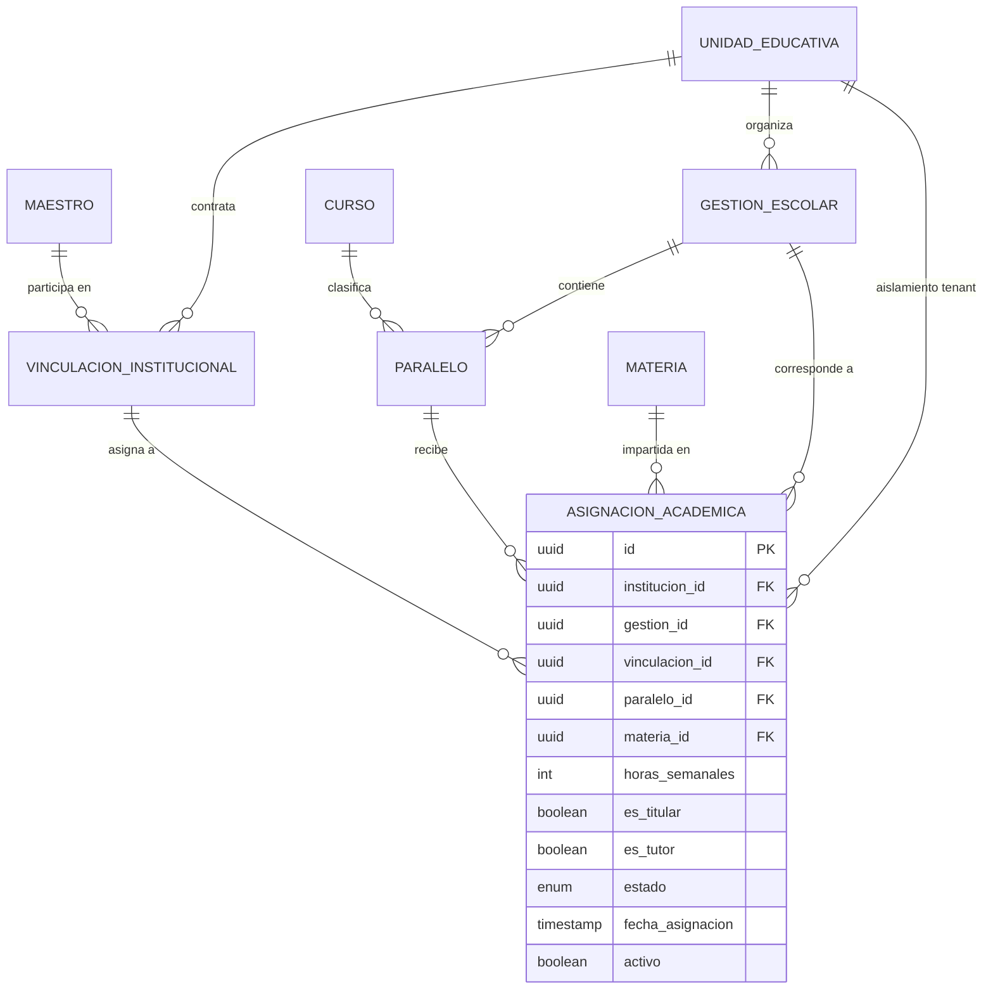

# Modelo de Datos — Feature 005: Asignaciones Académicas Docentes y Carga Horaria

**Feature:** `005-teacher-assignments`  
**Constitución Referencia:** V1.1.0 (Sección 4 - Entidad 10: Asignación Académica)

---

## 1. Diagrama Entidad-Relación Conceptual



---

## 2. Nuevo Modelo Prisma: `AsignacionAcademica`

```prisma
enum EstadoAsignacion {
  ACTIVA
  SUSPENDIDA
  FINALIZADA
}

model AsignacionAcademica {
  id              String           @id @default(uuid()) @db.Uuid
  institucionId   String           @map("institucion_id") @db.Uuid
  gestionId       String           @map("gestion_id") @db.Uuid
  vinculacionId   String           @map("vinculacion_id") @db.Uuid
  paraleloId       String           @map("paralelo_id") @db.Uuid
  materiaId       String           @map("materia_id") @db.Uuid
  horasSemanales  Int              @default(4) @map("horas_semanales")
  esTitular       Boolean          @default(true) @map("es_titular")
  esTutor         Boolean          @default(false) @map("es_tutor")
  estado          EstadoAsignacion @default(ACTIVA)
  fechaAsignacion DateTime         @default(now()) @map("fecha_asignacion")
  activo          Boolean          @default(true)
  createdAt       DateTime         @default(now()) @map("created_at")
  updatedAt       DateTime         @updatedAt @map("updated_at")

  // Relaciones
  institucion  UnidadEducativa          @relation(fields: [institucionId], references: [id], onDelete: Cascade)
  gestion      GestionEscolar           @relation(fields: [gestionId], references: [id], onDelete: Cascade)
  vinculacion  VinculacionInstitucional @relation(fields: [vinculacionId], references: [id], onDelete: Cascade)
  paralelo     Paralelo                 @relation(fields: [paraleloId], references: [id], onDelete: Cascade)
  materia      Materia                  @relation(fields: [materiaId], references: [id], onDelete: Cascade)

  @@unique([gestionId, paraleloId, materiaId, vinculacionId])
  @@index([institucionId])
  @@index([gestionId])
  @@index([vinculacionId])
  @@index([paraleloId])
  @@index([materiaId])
  @@map("asignaciones_academicas")
}
```

---

## 3. Políticas DDL de PostgreSQL Row Level Security (RLS)

```sql
-- Habilitar y forzar Row Level Security en la tabla asignaciones_academicas
ALTER TABLE "asignaciones_academicas" ENABLE ROW LEVEL SECURITY;
ALTER TABLE "asignaciones_academicas" FORCE ROW LEVEL SECURITY;

-- Política de aislamiento tenant: Solo registros donde institucion_id coincida con la sesión
CREATE POLICY "tenant_isolation_policy_asignaciones"
ON "asignaciones_academicas"
FOR ALL
USING (
  institucion_id = NULLIF(current_setting('app.current_institution_id', true), '')::uuid
)
WITH CHECK (
  institucion_id = NULLIF(current_setting('app.current_institution_id', true), '')::uuid
);
```

---

## 4. Reglas de Integridad y Validación

1. **Aislamiento Multi-Tenant Cruzado:**
   - `institucion_id` de `vinculacion_id` = `institucion_id` del request.
   - `institucion_id` de `paralelo_id` = `institucion_id` del request.
   - `institucion_id` de `gestion_id` = `institucion_id` del request.
2. **Coherencia Curricular de Nivel:**
   - `materia.nivel` == `paralelo.curso.nivel`.
3. **Titularidad Única:**
   - En una misma gestión, paralelo y materia, sólo puede existir una asignación activa con `es_titular = true`.
4. **Tutoría de Aula Única:**
   - En un mismo paralelo y gestión, sólo puede existir un docente titular con `es_tutor = true` (Asesor de Curso).

