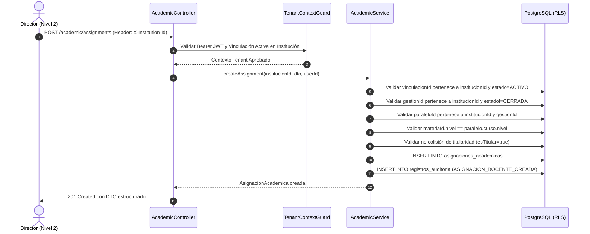

# Plan de Arquitectura e Implementación — Feature 005: Asignaciones Académicas Docentes y Carga Horaria

**Feature:** `005-teacher-assignments`  
**Constitución Referencia:** V1.1.0 (Decisiones 001, 002-B, 004, 005; Sección 4 - Modelo de Datos; Sección 6 - RBAC Contextual)  

---

## 1. Arquitectura Técnica y Estrategia de Dominio

Feature 005 consolida la triple vinculación de la plataforma:
1. **Identidad Docente** (Nivel Central - `Maestro`).
2. **Afiliación Institucional** (Nivel 2 - `VinculacionInstitucional`).
3. **Carga Pedagógica de Aula** (Nivel 3 - `AsignacionAcademica`).

### Patrón de Integración en el Backend
- Se integrará directamente en el módulo `AcademicModule` existente (`backend/src/modules/academic/`) extendiendo sus servicios y controladores.
- Opcionalmente se creará un sub-servicio o métodos dedicados dentro de `AcademicService` o `AssignmentsService` para mantener la modularidad y cohesión.
- Se implementarán DTOs de validación con `class-validator` y `class-transformer`:
  - `CreateAssignmentDto`
  - `UpdateAssignmentStatusDto`
  - `QueryAssignmentsDto`
- Toda interacción multi-tenant pasará por `TenantContextGuard` y el decorador `@CurrentTenant()`.
- Consultas de base de datos protegidas con RLS mediante `this.prisma.withTenantContext(institucionId, ...)`.

---

## 2. Flujo Operativo y Matriz de Validación

---

## 3. Matriz de Casos de Prueba (DoD)

### Pruebas Unitarias (`academic-assignments.spec.ts`):
1. **Rechazo por vinculación ajena:** Intentar asignar a un maestro cuya vinculación pertenezca a otra escuela -> `ForbiddenException`.
2. **Rechazo por vinculación inactiva:** Asignar a un maestro cesado o con licencia en esa escuela -> `BadRequestException`.
3. **Rechazo por gestión cerrada:** Asignar en una gestión con estado `CERRADA` -> `BadRequestException`.
4. **Rechazo por incoherencia de nivel:** Intentar asignar materia de Primaria en un aula de Secundaria -> `BadRequestException`.
5. **Rechazo por duplicidad:** Asignar al mismo docente dos veces en la misma materia y paralelo -> `ConflictException`.
6. **Rechazo por colisión de titular:** Asignar un segundo titular a una materia que ya tiene titular activo -> `ConflictException`.
7. **Creación exitosa:** Creación con normalización de horas y auditoría.

### Pruebas de Integración E2E (`academic-assignments.e2e-spec.ts`):
1. Director Elena asigna a Raúl Condori en "Biología y Geografía" de 1º A Secundaria en Franz Tamayo -> `201 Created`.
2. Intento de asignar materia de Primaria en 1º A Secundaria -> `400 Bad Request`.
3. Intentar crear segundo titular en 1º A Secundaria para Biología -> `409 Conflict`.
4. Superadmin asigna a Raúl Condori en Mariscal Sucre para Geografía -> `201 Created` (demuestra que el mismo maestro opera independientemente en ambas escuelas).
5. Raúl Condori consulta sus asignaciones en Franz Tamayo -> Ve únicamente sus materias en Franz Tamayo.
6. Raúl Condori cambia contexto a Mariscal Sucre y consulta -> Ve únicamente su materia en Mariscal Sucre.

