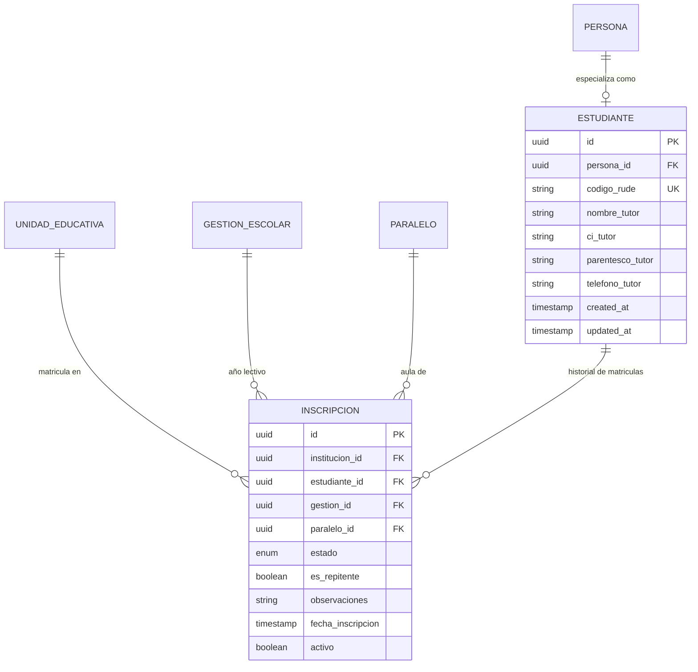

# Modelo de Datos — Feature 006: Empadronamiento de Estudiantes (RUDE) y Matriculación Escolar

**Feature:** `006-students-enrollment`  
**Constitución Referencia:** V1.1.0 (Sección 4 - Entidades 11 y 12: Estudiante e Inscripción)

---

## 1. Diagrama Entidad-Relación



---

## 2. Modelos Prisma

```prisma
enum ParentescoTutor {
  PADRE
  MADRE
  TUTOR_LEGAL
  ABUELO
  HERMANO
  OTRO
}

enum EstadoInscripcion {
  EFECTIVO
  RETIRADO_TRASLADO
  RETIRADO_ABANDONO
  NO_INCORPORADO
}

model Estudiante {
  id              String           @id @default(uuid()) @db.Uuid
  personaId       String           @unique @map("persona_id") @db.Uuid
  codigoRude      String           @unique @map("codigo_rude") @db.VarChar(50)
  nombreTutor     String?          @map("nombre_tutor") @db.VarChar(150)
  ciTutor         String?          @map("ci_tutor") @db.VarChar(20)
  parentescoTutor ParentescoTutor? @default(PADRE) @map("parentesco_tutor")
  telefonoTutor   String?          @map("telefono_tutor") @db.VarChar(30)
  createdAt       DateTime         @default(now()) @map("created_at")
  updatedAt       DateTime         @updatedAt @map("updated_at")

  persona       Persona       @relation(fields: [personaId], references: [id], onDelete: Cascade)
  inscripciones Inscripcion[]

  @@index([codigoRude])
  @@map("estudiantes")
}

model Inscripcion {
  id               String            @id @default(uuid()) @db.Uuid
  institucionId    String            @map("institucion_id") @db.Uuid
  estudianteId     String            @map("estudiante_id") @db.Uuid
  gestionId        String            @map("gestion_id") @db.Uuid
  paraleloId       String            @map("paralelo_id") @db.Uuid
  estado           EstadoInscripcion @default(EFECTIVO)
  esRepitente      Boolean           @default(false) @map("es_repitente")
  observaciones    String?           @db.VarChar(255)
  fechaInscripcion DateTime          @default(now()) @map("fecha_inscripcion")
  activo           Boolean           @default(true)
  createdAt        DateTime          @default(now()) @map("created_at")
  updatedAt        DateTime          @updatedAt @map("updated_at")

  institucion UnidadEducativa @relation(fields: [institucionId], references: [id], onDelete: Cascade)
  estudiante  Estudiante      @relation(fields: [estudianteId], references: [id], onDelete: Cascade)
  gestion     GestionEscolar  @relation(fields: [gestionId], references: [id], onDelete: Cascade)
  paralelo    Paralelo        @relation(fields: [paraleloId], references: [id], onDelete: Cascade)

  @@index([institucionId])
  @@index([estudianteId])
  @@index([gestionId])
  @@index([paraleloId])
  @@map("inscripciones")
}
```

---

## 3. Políticas DDL de PostgreSQL Row Level Security (RLS)

```sql
-- Habilitar y forzar Row Level Security en la tabla inscripciones
ALTER TABLE "inscripciones" ENABLE ROW LEVEL SECURITY;
ALTER TABLE "inscripciones" FORCE ROW LEVEL SECURITY;

-- Política tenant: solo registros que correspondan a la institución de la sesión
CREATE POLICY "tenant_isolation_policy_inscripciones"
ON "inscripciones"
FOR ALL
USING (
  institucion_id = NULLIF(current_setting('app.current_institution_id', true), '')::uuid
)
WITH CHECK (
  institucion_id = NULLIF(current_setting('app.current_institution_id', true), '')::uuid
);
```

---

## 4. Reglas de Validación de Integridad

1. **Unicidad de Matrícula Activa en la Gestión:**
   - Un estudiante no puede tener dos inscripciones con `estado = 'EFECTIVO'` en la misma `gestion_id` a nivel nacional.
2. **Validación de Cupo de Aula:**
   - Total de inscritos con `estado = 'EFECTIVO'` en `paralelo_id` < `paralelo.cupoMaximo`.
3. **Consistencia de Tenant:**
   - `paralelo.institucion_id` == `institucion_id` del request.
   - `gestion.institucion_id` == `institucion_id` del request.
   - `gestion.estado` != `CERRADA`.
