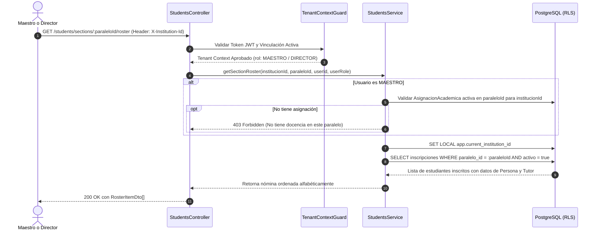

# Plan de Arquitectura e Implementación — Feature 006: Empadronamiento de Estudiantes (RUDE) y Matriculación Escolar

**Feature:** `006-students-enrollment`  
**Constitución Referencia:** V1.1.0 (Decisiones 001, 002-B, 004, 005; Sección 4 - Entidades 11 y 12; Sección 6 - RBAC Contextual)  

---

## 1. Arquitectura Técnica y Estrategia de Módulo

Para mantener la alta cohesión del monolito modular NestJS y evitar sobrecargar los módulos existentes:
- Crearemos un nuevo módulo de dominio: `StudentsModule` (`backend/src/modules/students/`).
- Componentes:
  - `StudentsController`: Endpoints REST para `/api/v1/students`.
  - `StudentsService`: Lógica de empadronamiento, matriculación, control de cupo, traspasos y armado de listas de aula.
  - DTOs fuertemente tipados con `class-validator` y Swagger.
  - Inyección de `PrismaService` y `AuditService`.
  - Integración en `AppModule`.

---

## 2. Flujo de Autorización y Acceso al Roster de Aula

---

## 3. Matriz de Casos de Prueba (DoD)

### Pruebas Unitarias (`students.service.spec.ts`):
1. **RUDE Duplicado:** Rechaza empadronar estudiante con RUDE ya existente -> `ConflictException`.
2. **Matrícula en Gestión Cerrada:** Rechaza matricular en gestión con estado `CERRADA` -> `BadRequestException`.
3. **Paralelo de otro Colegio:** Rechaza matricular en aula perteneciente a otro tenant -> `NotFoundException`.
4. **Matrícula Doble Activa en el Año:** Rechaza si el alumno ya tiene matrícula `EFECTIVO` en esa gestión -> `ConflictException`.
5. **Superación de Cupo de Aula:** Rechaza si el paralelo ya alcanzó su `cupoMaximo` de inscritos activos -> `BadRequestException`.
6. **Acceso al Roster por Docente no asignado:** Docente sin asignación en el aula es rechazado -> `ForbiddenException`.
7. **Acceso al Roster por Docente asignado o Director:** Retorna lista ordenada alfabéticamente por apellidos.
8. **Traspaso Escolar:** Cambia estado a `RETIRADO_TRASLADO` y registra auditoría.

### Pruebas de Integración E2E (`students.e2e-spec.ts`):
1. Directora Elena registra al estudiante Mateo Mamani con RUDE oficial en Franz Tamayo -> `201 Created`.
2. Elena matricula a Mateo en "1º A Secundaria" -> `201 Created` (`EFECTIVO`).
3. Intento de matricular a Mateo por segunda vez en la misma gestión escolar (incluso en otro colegio) -> `409 Conflict`.
4. Maestro Raúl Condori consulta la nómina de "1º A Secundaria" (donde enseña Biología) -> `200 OK` (ve a Mateo en la lista).
5. Maestro Pedro Gutiérrez intenta consultar la nómina de un paralelo donde NO enseña -> `403 Forbidden`.
6. Elena registra el traspaso de Mateo a `RETIRADO_TRASLADO` -> `200 OK`.
7. Superadmin matricula a Mateo en Mariscal Sucre (demostrando éxito del traspaso escolar) -> `201 Created`.
