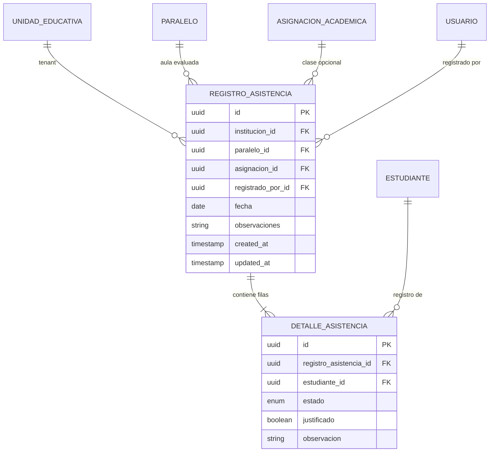

# Modelo de Datos — Feature 007: Control de Asistencia y Justificaciones

**Feature:** `007-attendance-control`  
**Constitución Referencia:** V1.1.0 (Sección 4 - Entidad 15: Asistencia)

---

## 1. Diagrama Entidad-Relación



---

## 2. Modelos Prisma

```prisma
enum EstadoAsistencia {
  PRESENTE
  FALTA
  LICENCIA
  ATRASO
}

model RegistroAsistencia {
  id              String   @id @default(uuid()) @db.Uuid
  institucionId   String   @map("institucion_id") @db.Uuid
  paraleloId      String   @map("paralelo_id") @db.Uuid
  asignacionId    String?  @map("asignacion_id") @db.Uuid
  registradoPorId String   @map("registrado_por_id") @db.Uuid
  fecha           DateTime @db.Date
  observaciones   String?  @db.VarChar(255)
  createdAt       DateTime @default(now()) @map("created_at")
  updatedAt       DateTime @updatedAt @map("updated_at")

  institucion   UnidadEducativa      @relation(fields: [institucionId], references: [id], onDelete: Cascade)
  paralelo      Paralelo             @relation(fields: [paraleloId], references: [id], onDelete: Cascade)
  asignacion    AsignacionAcademica? @relation(fields: [asignacionId], references: [id], onDelete: SetNull)
  registradoPor Usuario              @relation(fields: [registradoPorId], references: [id], onDelete: Restrict)
  detalles      DetalleAsistencia[]

  @@unique([paraleloId, fecha, asignacionId])
  @@index([institucionId])
  @@index([paraleloId])
  @@index([fecha])
  @@index([asignacionId])
  @@map("registros_asistencia")
}

model DetalleAsistencia {
  id                   String           @id @default(uuid()) @db.Uuid
  registroAsistenciaId String           @map("registro_asistencia_id") @db.Uuid
  estudianteId         String           @map("estudiante_id") @db.Uuid
  estado               EstadoAsistencia @default(PRESENTE)
  justificado          Boolean          @default(false)
  observacion          String?          @db.VarChar(255)

  registroAsistencia RegistroAsistencia @relation(fields: [registroAsistenciaId], references: [id], onDelete: Cascade)
  estudiante         Estudiante         @relation(fields: [estudianteId], references: [id], onDelete: Cascade)

  @@unique([registroAsistenciaId, estudianteId])
  @@index([registroAsistenciaId])
  @@index([estudianteId])
  @@map("detalles_asistencia")
}
```

---

## 3. Políticas DDL de PostgreSQL Row Level Security (RLS)

```sql
-- Habilitar y forzar Row Level Security en la tabla registros_asistencia
ALTER TABLE "registros_asistencia" ENABLE ROW LEVEL SECURITY;
ALTER TABLE "registros_asistencia" FORCE ROW LEVEL SECURITY;

CREATE POLICY "tenant_isolation_policy_asistencia"
ON "registros_asistencia"
FOR ALL
USING (
  institucion_id = NULLIF(current_setting('app.current_institution_id', true), '')::uuid
)
WITH CHECK (
  institucion_id = NULLIF(current_setting('app.current_institution_id', true), '')::uuid
);
```

---

## 4. Reglas de Validación de Integridad

1. **Unicidad de Registro por Sesión:** No puede registrarse dos veces la asistencia para el mismo paralelo, fecha y materia (`@@unique([paraleloId, fecha, asignacionId])`).
2. **Fecha Válida:** La fecha del registro no puede ser posterior a la fecha actual.
3. **Pertenencia de Estudiantes al Aula:** Cada `estudianteId` del detalle debe contar con una matrícula en estado `EFECTIVO` en el `paraleloId` y gestión del registro.
4. **Pertenencia al Tenant:** `paralelo.institucion_id` == `institucion_id` del request.
