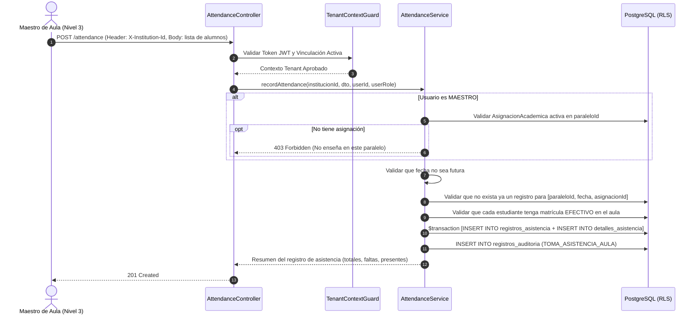

# Plan de Arquitectura e Implementación — Feature 007: Control de Asistencia y Justificaciones

**Feature:** `007-attendance-control`  
**Constitución Referencia:** V1.1.0 (Decisiones 001, 002-B, 005; Sección 4 - Entidad 15; Sección 6 - RBAC Contextual)  

---

## 1. Arquitectura Técnica y Estrategia de Dominio

Feature 007 implementa el módulo de asistencia en el backend NestJS como un dominio independiente de alta cohesión:
- **Nuevo Módulo:** `AttendanceModule` (`backend/src/modules/attendance/`).
- **Componentes:**
  - `AttendanceController`: Endpoints REST `/api/v1/attendance`.
  - `AttendanceService`: Lógica de validación, registro atómico en bloque, justificaciones y cálculo de estadísticas.
  - DTOs fuertemente tipados con `class-validator` y Swagger.
  - Inyección de `PrismaService` y `AuditService`.
  - Integración en `AppModule`.
- **Aislamiento Multi-Tenant:**
  - `TenantContextGuard` valida `X-Institution-Id`.
  - `this.prisma.withTenantContext(institucionId, ...)` asegura aislamiento con RLS.

---

## 2. Flujo Operativo de Registro en Bloque

---

## 3. Matriz de Casos de Prueba (DoD)

### Pruebas Unitarias (`attendance.service.spec.ts`):
1. **Fecha Futura:** Rechaza registrar asistencia con fecha posterior al día de hoy -> `BadRequestException`.
2. **Duplicidad de Registro:** Rechaza si ya existe un registro para la misma aula y fecha -> `ConflictException`.
3. **Docente No Asignado:** Rechaza si un maestro intenta registrar asistencia en un aula donde no enseña -> `ForbiddenException`.
4. **Estudiante No Matriculado:** Rechaza si se incluye a un alumno que no pertenece al paralelo -> `BadRequestException`.
5. **Registro Exitoso en Bloque:** Guarda encabezado y detalles atómicamente y registra auditoría.
6. **Justificación:** Conmuta `FALTA` a `LICENCIA` con motivo y auditoría.
7. **Estadísticas:** Calcula totales de sesiones, porcentaje global y desglose por estudiante.

### Pruebas de Integración E2E (`attendance.e2e-spec.ts`):
1. Maestro Hugo (asignado a 1º A) toma asistencia del aula completa -> `201 Created`.
2. Intento de duplicar asistencia para la misma fecha -> `409 Conflict`.
3. Maestro Jaime (NO asignado a 1º A) intenta tomar asistencia en 1º A -> `403 Forbidden`.
4. Consulta de planilla de asistencia por fecha -> `200 OK`.
5. Secretaria justifica la falta de un estudiante por certificado médico -> `200 OK` (estado `LICENCIA`).
6. Consulta de reporte consolidado de asistencia mensual -> `200 OK` con métricas exactas.
