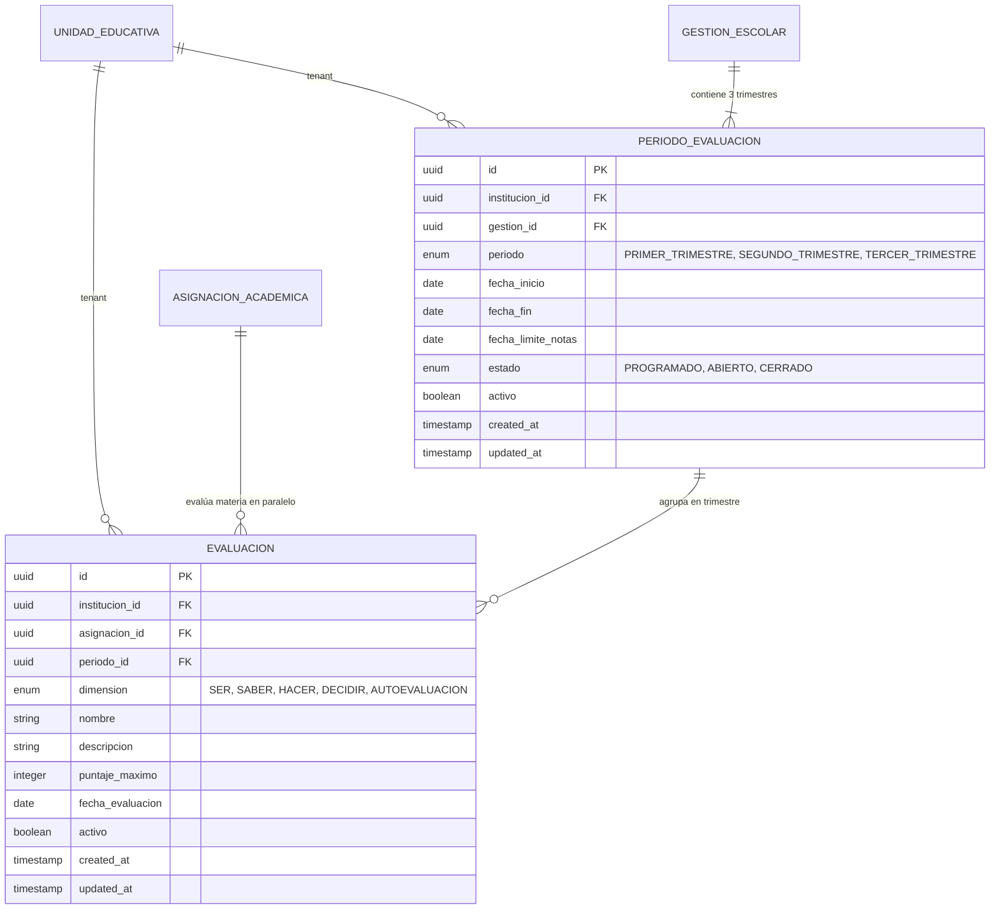

# Modelo de Datos — Feature 008: Periodos de Evaluación y Configuración de Dimensiones SEP

**Feature:** `008-evaluation-periods`  
**Constitución Referencia:** V1.1.0 (Sección 4 - Entidades 7 y 13)

---

## 1. Diagrama Entidad-Relación



---

## 2. Modelos Prisma

```prisma
enum TipoPeriodo {
  PRIMER_TRIMESTRE
  SEGUNDO_TRIMESTRE
  TERCER_TRIMESTRE
}

enum EstadoPeriodo {
  PROGRAMADO
  ABIERTO
  CERRADO
}

enum DimensionEvaluacion {
  SER
  SABER
  HACER
  DECIDIR
  AUTOEVALUACION
}

model PeriodoEvaluacion {
  id               String        @id @default(uuid()) @db.Uuid
  institucionId    String        @map("institucion_id") @db.Uuid
  gestionId        String        @map("gestion_id") @db.Uuid
  periodo          TipoPeriodo
  fechaInicio      DateTime      @map("fecha_inicio") @db.Date
  fechaFin         DateTime      @map("fecha_fin") @db.Date
  fechaLimiteNotas DateTime      @map("fecha_limite_notas") @db.Date
  estado           EstadoPeriodo @default(PROGRAMADO)
  activo           Boolean       @default(true)
  createdAt        DateTime      @default(now()) @map("created_at")
  updatedAt        DateTime      @updatedAt @map("updated_at")

  institucion  UnidadEducativa @relation(fields: [institucionId], references: [id], onDelete: Cascade)
  gestion      GestionEscolar  @relation(fields: [gestionId], references: [id], onDelete: Cascade)
  evaluaciones Evaluacion[]

  @@unique([gestionId, periodo])
  @@index([institucionId])
  @@index([gestionId])
  @@index([estado])
  @@map("periodos_evaluacion")
}

model Evaluacion {
  id              String              @id @default(uuid()) @db.Uuid
  institucionId   String              @map("institucion_id") @db.Uuid
  asignacionId    String              @map("asignacion_id") @db.Uuid
  periodoId       String              @map("periodo_id") @db.Uuid
  dimension       DimensionEvaluacion
  nombre          String              @db.VarChar(150)
  descripcion     String?             @db.VarChar(255)
  puntajeMaximo   Int                 @map("puntaje_maximo")
  fechaEvaluacion DateTime            @map("fecha_evaluacion") @db.Date
  activo          Boolean             @default(true)
  createdAt       DateTime            @default(now()) @map("created_at")
  updatedAt       DateTime            @updatedAt @map("updated_at")

  institucion UnidadEducativa     @relation(fields: [institucionId], references: [id], onDelete: Cascade)
  asignacion  AsignacionAcademica @relation(fields: [asignacionId], references: [id], onDelete: Cascade)
  periodo     PeriodoEvaluacion   @relation(fields: [periodoId], references: [id], onDelete: Cascade)

  @@index([institucionId])
  @@index([asignacionId])
  @@index([periodoId])
  @@index([dimension])
  @@index([fechaEvaluacion])
  @@map("evaluaciones")
}
```

---

## 3. Políticas DDL de PostgreSQL Row Level Security (RLS)

```sql
-- Habilitar y forzar Row Level Security en periodos_evaluacion
ALTER TABLE "periodos_evaluacion" ENABLE ROW LEVEL SECURITY;
ALTER TABLE "periodos_evaluacion" FORCE ROW LEVEL SECURITY;

CREATE POLICY "tenant_isolation_policy_periodos_evaluacion"
ON "periodos_evaluacion"
FOR ALL
USING (
  institucion_id = NULLIF(current_setting('app.current_institution_id', true), '')::uuid
)
WITH CHECK (
  institucion_id = NULLIF(current_setting('app.current_institution_id', true), '')::uuid
);

-- Habilitar y forzar Row Level Security en evaluaciones
ALTER TABLE "evaluaciones" ENABLE ROW LEVEL SECURITY;
ALTER TABLE "evaluaciones" FORCE ROW LEVEL SECURITY;

CREATE POLICY "tenant_isolation_policy_evaluaciones"
ON "evaluaciones"
FOR ALL
USING (
  institucion_id = NULLIF(current_setting('app.current_institution_id', true), '')::uuid
)
WITH CHECK (
  institucion_id = NULLIF(current_setting('app.current_institution_id', true), '')::uuid
);
```

---

## 4. Topes Reglamentarios de Dimensiones SEP

| Dimensión | Puntaje Máximo Reglamentario | Regla de Validación de Negocio |
|---|---|---|
| `SER` | 10 | $\sum \text{puntajeMaximo}(\text{SER}) \le 10$ |
| `SABER` | 35 | $\sum \text{puntajeMaximo}(\text{SABER}) \le 35$ |
| `HACER` | 35 | $\sum \text{puntajeMaximo}(\text{HACER}) \le 35$ |
| `DECIDIR` | 10 | $\sum \text{puntajeMaximo}(\text{DECIDIR}) \le 10$ |
| `AUTOEVALUACION` | 10 | $\sum \text{puntajeMaximo}(\text{AUTOEVALUACION}) \le 10$ |
| **Total Trimestre** | **100** | Máximo acumulable por trimestre |
