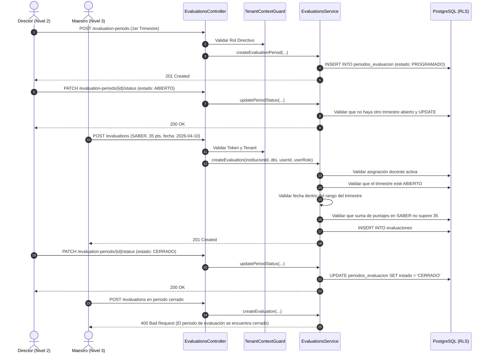

# Plan de Arquitectura e Implementación — Feature 008: Periodos de Evaluación y Configuración de Dimensiones SEP

**Feature:** `008-evaluation-periods`  
**Constitución Referencia:** V1.1.0 (Decisiones 001, 002-B, 005; Sección 4 - Entidades 7 y 13; Sección 6 - RBAC Contextual; Sección 7 - Módulo 12)  

---

## 1. Arquitectura Técnica y Estrategia de Dominio

Feature 008 implementa la gestión de periodos evaluativos (trimestres) e instrumentos curriculares en el backend NestJS como el módulo `EvaluationsModule` (`backend/src/modules/evaluations/`):
- **Componentes:**
  - `EvaluationsController`: Endpoints REST para `/api/v1/evaluation-periods` y `/api/v1/evaluations`.
  - `EvaluationsService`: Lógica de validación de trimestres, conmutación de estados, autorización de asignaciones pedagógicas y control estricto de topes por dimensión (SER $\le 10$, SABER $\le 35$, HACER $\le 35$, DECIDIR $\le 10$, AUTOEVALUACION $\le 10$).
  - DTOs fuertemente tipados con Swagger y `class-validator`.
  - Integración en `AppModule`.
- **Aislamiento Multi-Tenant:**
  - `TenantContextGuard` valida `X-Institution-Id`.
  - `withTenantContext` aplica aislamiento PostgreSQL RLS a `periodos_evaluacion` y `evaluaciones`.

---

## 2. Flujo Operativo de Creación de Evaluación y Bloqueo

---

## 3. Matriz de Casos de Prueba (DoD)

### Pruebas Unitarias (`evaluations.service.spec.ts`):
1. **Fechas Inválidas:** Rechaza periodo con `fechaInicio >= fechaFin` -> `BadRequestException`.
2. **Trimestre Duplicado:** Rechaza si ya existe el mismo trimestre para la gestión -> `ConflictException`.
3. **Múltiples Trimestres Abiertos:** Rechaza abrir un trimestre si otro ya está `ABIERTO` -> `BadRequestException`.
4. **Maestro No Asignado:** Rechaza si un docente crea una evaluación en una materia/paralelo que no enseña -> `ForbiddenException`.
5. **Periodo No Abierto:** Rechaza crear evaluación si el trimestre está `PROGRAMADO` o `CERRADO` -> `BadRequestException`.
6. **Fecha Fuera de Rango:** Rechaza evaluación con fecha fuera de los límites del trimestre -> `BadRequestException`.
7. **Exceso de Puntaje de Dimensión:** Rechaza si el puntaje supera el tope de la dimensión (ej. SABER $> 35$ o SER $> 10$) -> `BadRequestException`.
8. **Exceso de Sumatoria:** Rechaza si la suma de evaluaciones programadas en la dimensión sobrepasa el tope -> `BadRequestException`.
9. **Creación Exitosa:** Persiste bajo contexto RLS y audita el evento.
10. **Modificación y Borrado Bloqueados en Periodo Cerrado:** Lanza `BadRequestException`.

### Pruebas de Integración E2E (`evaluations.e2e-spec.ts`):
1. Directora Elena registra los 3 trimestres de la Gestión 2026 -> `201 Created`.
2. Directora Elena abre el 1er Trimestre -> `200 OK`.
3. Maestro Hugo crea evaluaciones en Matemática (SABER 20 pts, SABER 15 pts, HACER 35 pts, SER 10 pts, DECIDIR 10 pts) -> `201 Created`.
4. Intento de Maestro Hugo de crear una evaluación en SABER por 10 pts adicionales (sumaría 45 $> 35$) -> `400 Bad Request`.
5. Maestro Jaime (no asignado a 1º A) intenta crear una evaluación en 1º A -> `403 Forbidden`.
6. Directora Elena cierra el 1er Trimestre -> `200 OK`.
7. Intento de Maestro Hugo de modificar una evaluación en el trimestre cerrado -> `400 Bad Request`.
8. Aislamiento PostgreSQL RLS: consulta desde colegio ajeno -> `404 Not Found` / no visibilidad.
