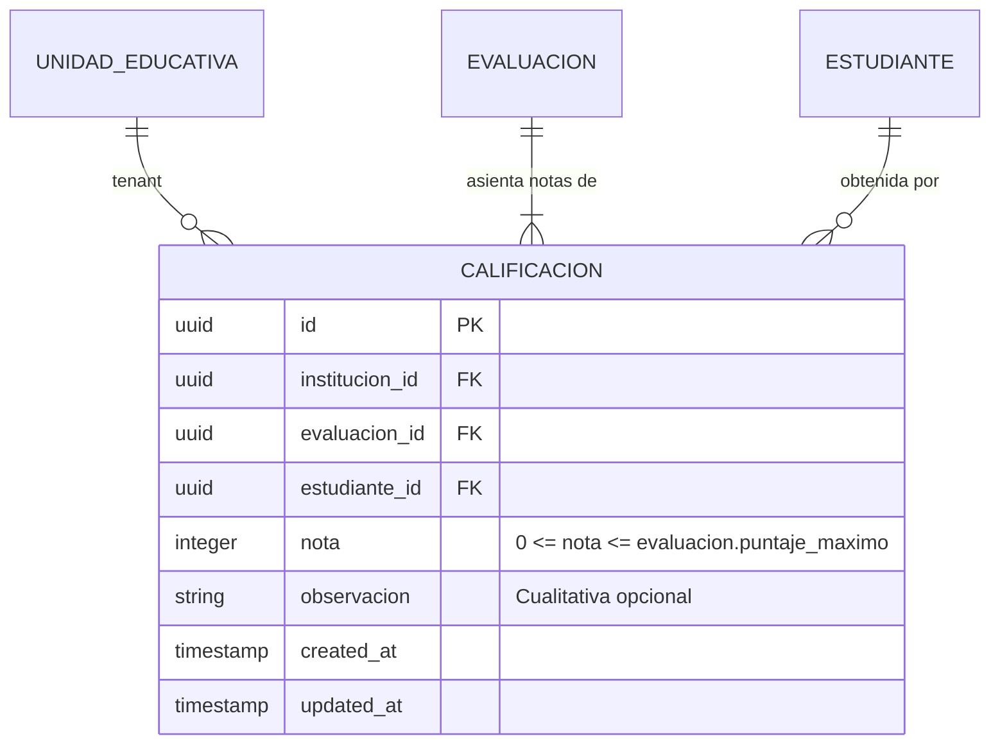

# Modelo de Datos — Feature 009: Registro de Calificaciones Cuantitativas y Cualitativas

**Feature:** `009-grades-recording`  
**Constitución Referencia:** V1.1.0 (Sección 4 - Entidad 14: Calificación)

---

## 1. Diagrama Entidad-Relación



---

## 2. Modelo Prisma

```prisma
model Calificacion {
  id            String   @id @default(uuid()) @db.Uuid
  institucionId String   @map("institucion_id") @db.Uuid
  evaluacionId  String   @map("evaluacion_id") @db.Uuid
  estudianteId  String   @map("estudiante_id") @db.Uuid
  nota          Int
  observacion   String?  @db.VarChar(255)
  createdAt     DateTime @default(now()) @map("created_at")
  updatedAt     DateTime @updatedAt @map("updated_at")

  institucion UnidadEducativa @relation(fields: [institucionId], references: [id], onDelete: Cascade)
  evaluacion  Evaluacion      @relation(fields: [evaluacionId], references: [id], onDelete: Cascade)
  estudiante  Estudiante      @relation(fields: [estudianteId], references: [id], onDelete: Cascade)

  @@unique([evaluacionId, estudianteId])
  @@index([institucionId])
  @@index([evaluacionId])
  @@index([estudianteId])
  @@map("calificaciones")
}
```

---

## 3. Políticas DDL de PostgreSQL Row Level Security (RLS)

```sql
-- Habilitar y forzar Row Level Security en la tabla calificaciones
ALTER TABLE "calificaciones" ENABLE ROW LEVEL SECURITY;
ALTER TABLE "calificaciones" FORCE ROW LEVEL SECURITY;

CREATE POLICY "tenant_isolation_policy_calificaciones"
ON "calificaciones"
FOR ALL
USING (
  institucion_id = NULLIF(current_setting('app.current_institution_id', true), '')::uuid
)
WITH CHECK (
  institucion_id = NULLIF(current_setting('app.current_institution_id', true), '')::uuid
);
```

---

## 4. Estructura de Consolidación Trimestral (Fórmulas SEP)

$$\text{Subtotal SER} = \sum_{\text{evaluaciones } \in \text{ SER}} \text{nota}_i \quad (\le 10)$$
$$\text{Subtotal SABER} = \sum_{\text{evaluaciones } \in \text{ SABER}} \text{nota}_i \quad (\le 35)$$
$$\text{Subtotal HACER} = \sum_{\text{evaluaciones } \in \text{ HACER}} \text{nota}_i \quad (\le 35)$$
$$\text{Subtotal DECIDIR} = \sum_{\text{evaluaciones } \in \text{ DECIDIR}} \text{nota}_i \quad (\le 10)$$
$$\text{Subtotal AUTOEVALUACIÓN} = \sum_{\text{evaluaciones } \in \text{ AUTOEVALUACION}} \text{nota}_i \quad (\le 10)$$

$$\text{Nota Trimestral} = \text{SER} + \text{SABER} + \text{HACER} + \text{DECIDIR} + \text{AUTOEVALUACIÓN} \quad \in [0, 100]$$

$$\text{Estado Aprobación} = \begin{cases} 
\text{APROBADO} & \text{si } \text{Nota Trimestral} \ge 51 \\ 
\text{EN\_DESARROLLO} & \text{si } \text{Nota Trimestral} < 51 
\end{cases}$$

