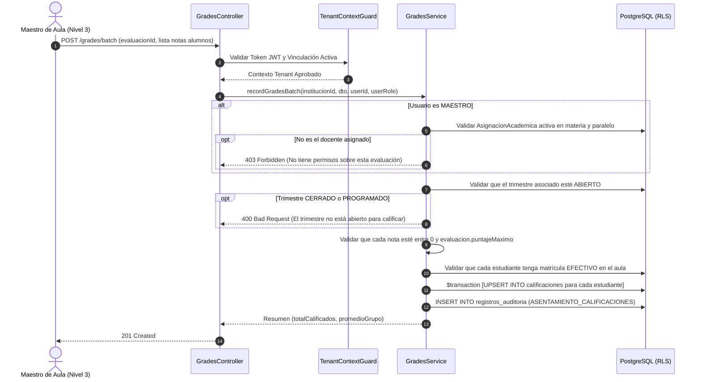

# Plan de Arquitectura e Implementación — Feature 009: Registro de Calificaciones Cuantitativas y Cualitativas

**Feature:** `009-grades-recording`  
**Constitución Referencia:** V1.1.0 (Decisiones 001, 002-B, 005; Sección 4 - Entidad 14; Sección 6 - RBAC Contextual; Sección 7 - Módulo 13)  

---

## 1. Arquitectura Técnica y Estrategia de Dominio

Feature 009 implementa el asentamiento y consolidación de calificaciones en el backend NestJS como el módulo `GradesModule` (`backend/src/modules/grades/`):
- **Componentes:**
  - `GradesController`: Endpoints REST bajo `/api/v1/grades`.
  - `GradesService`: Lógica de validación de asignaciones docentes, control de estado del trimestre (`ABIERTO`), validación de notas dentro del rango estatuario del instrumento ($0 \le \text{nota} \le \text{puntajeMaximo}$), operaciones atómicas en bloque (`upsert`) y agregación de dimensiones del modelo educativo boliviano.
  - DTOs fuertemente tipados con `class-validator` y Swagger.
  - Integración en `AppModule`.
- **Aislamiento Multi-Tenant:**
  - `TenantContextGuard` valida `X-Institution-Id`.
  - `withTenantContext` aplica aislamiento PostgreSQL RLS a `calificaciones`.

---

## 2. Flujo Operativo de Asentamiento de Calificaciones en Bloque

---

## 3. Matriz de Casos de Prueba (DoD)

### Pruebas Unitarias (`grades.service.spec.ts`):
1. **Docente No Autorizado:** Rechaza asentar notas si el maestro no es titular de la asignación -> `ForbiddenException`.
2. **Trimestre No Abierto:** Rechaza si el periodo evaluativo está `PROGRAMADO` o `CERRADO` -> `BadRequestException`.
3. **Puntaje Fuera de Rango:** Rechaza nota menor a 0 o mayor al `puntajeMaximo` del instrumento -> `BadRequestException`.
4. **Estudiante No Matriculado:** Rechaza si se califica a un estudiante ajeno al paralelo o sin matrícula `EFECTIVO` -> `BadRequestException`.
5. **Carga Exitosa en Bloque:** Guarda calificaciones atómicamente, calcula promedio grupal y registra auditoría.
6. **Planilla Consolidada Trimestral:** Calcula con precisión subtotales Ser, Saber, Hacer, Decidir, Autoevaluación, nota final (1-100) y marca `APROBADO` ($\ge 51$) o `EN_DESARROLLO` ($< 51$).
7. **Modificación Individual:** Actualiza nota con traza inmutable del valor anterior y nuevo.
8. **Modificación en Trimestre Cerrado:** Lanza `BadRequestException`.

### Pruebas de Integración E2E (`grades.e2e-spec.ts`):
1. Maestro Hugo asienta notas en SABER (máx 20 pts) para Mateo (18) y Lucia (15) -> `201 Created`.
2. Intento de ingresar nota superior al máximo (25 en instrumento de 20) -> `400 Bad Request`.
3. Intento de calificar a un estudiante matriculado en otro paralelo -> `400 Bad Request`.
4. Maestro Jaime (no asignado) intenta asentar notas en el paralelo de Hugo -> `403 Forbidden`.
5. Maestro Hugo asienta notas en las demás dimensiones (HACER, SER, DECIDIR, AUTOEVALUACION) -> `201 Created`.
6. Consulta de planilla consolidada trimestral -> `200 OK` (notas finales consolidadas y estados de aprobación verificados).
7. Corrección individual de una nota con motivo -> `200 OK` (auditoría registrada).
8. Directora Elena cierra el trimestre escolar -> `200 OK`.
9. Intento de modificar notas en trimestre cerrado -> `400 Bad Request`.
10. Aislamiento PostgreSQL RLS: consulta desde tenant ajeno -> `404 Not Found`.

