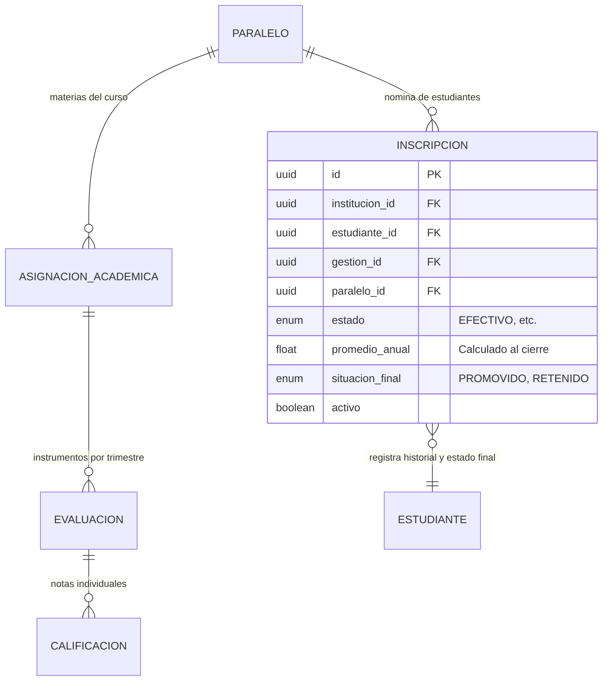

# Modelo de Datos — Feature 010: Centralizadores de Calificaciones y Promedios Anuales

**Feature:** `010-grades-centralizers`  
**Constitución Referencia:** V1.1.0 (Sección 4 - Entidades 8, 9, 12 y 14)

---

## 1. Diagrama de Relaciones para Centralizadores



---

## 2. Extensiones al Modelo Prisma

```prisma
enum SituacionFinalEstudiante {
  PROMOVIDO
  RETENIDO
}

// En model Inscripcion:
model Inscripcion {
  id               String                    @id @default(uuid()) @db.Uuid
  institucionId    String                    @map("institucion_id") @db.Uuid
  estudianteId     String                    @map("estudiante_id") @db.Uuid
  gestionId        String                    @map("gestion_id") @db.Uuid
  paraleloId       String                    @map("paralelo_id") @db.Uuid
  estado           EstadoInscripcion         @default(EFECTIVO)
  esRepitente      Boolean                   @default(false) @map("es_repitente")
  promedioAnual    Float?                    @map("promedio_anual")
  situacionFinal   SituacionFinalEstudiante? @map("situacion_final")
  observaciones    String?                   @db.VarChar(255)
  fechaInscripcion DateTime                  @default(now()) @map("fecha_inscripcion")
  activo           Boolean                   @default(true)
  createdAt        DateTime                  @default(now()) @map("created_at")
  updatedAt        DateTime                  @updatedAt @map("updated_at")

  institucion UnidadEducativa @relation(fields: [institucionId], references: [id], onDelete: Cascade)
  estudiante  Estudiante      @relation(fields: [estudianteId], references: [id], onDelete: Cascade)
  gestion     GestionEscolar  @relation(fields: [gestionId], references: [id], onDelete: Cascade)
  paralelo    Paralelo        @relation(fields: [paraleloId], references: [id], onDelete: Cascade)

  @@index([institucionId])
  @@index([estudianteId])
  @@index([gestionId])
  @@index([paraleloId])
  @@map("inscripciones")
}
```

---

## 3. Fórmulas de Agregación Matricial

### 1. Nota Final de Asignatura por Trimestre:
$$\text{Nota Trimestral}(e, m, t) = \sum_{d \in \text{Dimensiones}} \sum_{\text{eval}_i \in \text{evaluaciones}(m, t, d)} \text{calificacion}(e, \text{eval}_i) \in [0, 100]$$

### 2. Promedio Trimestral del Estudiante:
$$\overline{\text{Nota}}_e(t) = \text{round}\left(\frac{1}{|M|} \sum_{m \in M} \text{Nota Trimestral}(e, m, t)\right)$$

### 3. Promedio Anual de la Materia:
$$\overline{\text{Anual}}(e, m) = \text{round}\left(\frac{\text{Nota}(e, m, 1\text{T}) + \text{Nota}(e, m, 2\text{T}) + \text{Nota}(e, m, 3\text{T})}{3}\right)$$

### 4. Situación Final:
$$\text{Situación Final}(e) = \begin{cases}
\text{PROMOVIDO} & \text{si } \forall m \in M: \overline{\text{Anual}}(e, m) \ge 51 \\
\text{RETENIDO} & \text{si } \exists m \in M: \overline{\text{Anual}}(e, m) < 51
\end{cases}$$
