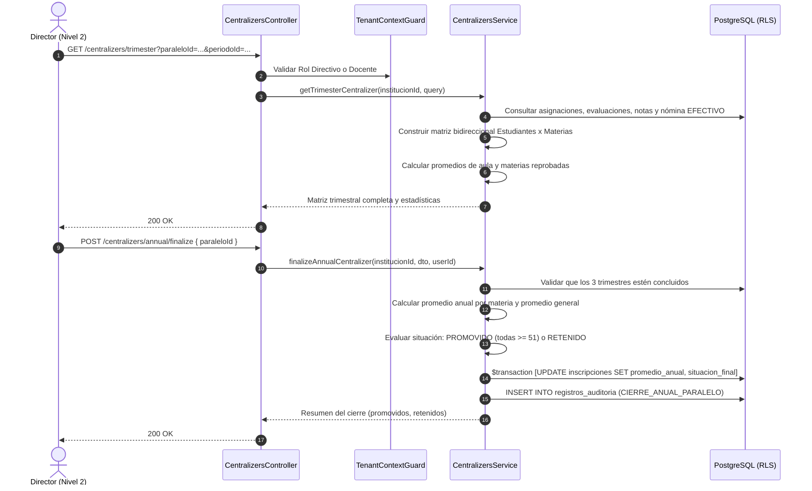

# Plan de Arquitectura e Implementación — Feature 010: Centralizadores de Calificaciones y Promedios Anuales

**Feature:** `010-grades-centralizers`  
**Constitución Referencia:** V1.1.0 (Decisiones 001, 002-B, 005; Sección 4 - Entidades 8, 9, 12 y 14; Sección 6 - RBAC Contextual; Sección 7 - Módulo 14)  

---

## 1. Arquitectura Técnica y Estrategia de Dominio

Feature 010 implementa el motor de centralización académica y determinación de situación final en el backend NestJS como el módulo `CentralizersModule` (`backend/src/modules/centralizers/`):
- **Componentes:**
  - `CentralizersController`: Endpoints REST bajo `/api/v1/centralizers`.
  - `CentralizersService`: Lógica matricial de agregación de estudiantes $\times$ asignaturas, cálculo de notas por trimestre (Ser, Saber, Hacer, Decidir, Autoevaluación), cómputo de promedios anuales y regla oficial de promoción (`PROMOVIDO` si todas las materias tienen promedio anual $\ge 51$, de lo contrario `RETENIDO`).
  - DTOs fuertemente tipados con validación y Swagger.
  - Integración en `AppModule`.
- **Aislamiento Multi-Tenant:**
  - `TenantContextGuard` valida `X-Institution-Id`.
  - `withTenantContext` aplica aislamiento PostgreSQL RLS a todas las consultas y a las actualizaciones de `inscripciones`.

---

## 2. Flujo Operativo de Centralización y Cierre Anual

---

## 3. Matriz de Casos de Prueba (DoD)

### Pruebas Unitarias (`centralizers.service.spec.ts`):
1. **Centralizador Trimestral:** Cruza estudiantes y materias, calcula correctamente el promedio trimestral del estudiante y cuenta asignaturas reprobadas.
2. **Estadísticas de Aula Trimestral:** Calcula con precisión el total de aprobados en todo, reprobados y promedio general del curso.
3. **Centralizador Anual:** Promedia los 3 trimestres por materia: $\text{round}((\text{1T} + \text{2T} + \text{3T}) / 3)$ y promedio general.
4. **Criterio de Promoción Oficial:**
   - Estudiante con todas las materias $\ge 51$ -> `PROMOVIDO`.
   - Estudiante con una sola materia $< 51$ -> `RETENIDO`.
5. **Finalización Anual:** Actualiza `Inscripcion.promedioAnual` y `Inscripcion.situacionFinal` bajo RLS y registra auditoría.

### Pruebas de Integración E2E (`centralizers.e2e-spec.ts`):
1. Configuración de 1º A con 2 materias (Matemática y Biología) y 2 estudiantes (Mateo y Lucia).
2. Asentamiento de notas en los 3 trimestres:
   - Mateo: aprueba ambas materias en todos los trimestres (promedio $> 80$).
   - Lucia: aprueba Matemática pero reprueba Biología (promedio anual 45).
3. Consulta del Centralizador Trimestral de 1T -> `200 OK` (notas y promedios exactos).
4. Consulta del Centralizador Anual -> `200 OK` (desglose anual de 1T, 2T, 3T).
5. Directora Elena ejecuta la finalización oficial del paralelo (`POST /centralizers/annual/finalize`) -> `200 OK` (1 promovido, 1 retenido).
6. Ficha del estudiante (`GET /students/:id`) refleja la `situacionFinal: PROMOVIDO` para Mateo y `RETENIDO` para Lucia.
7. Aislamiento PostgreSQL RLS: consulta desde colegio ajeno -> `404 Not Found`.

