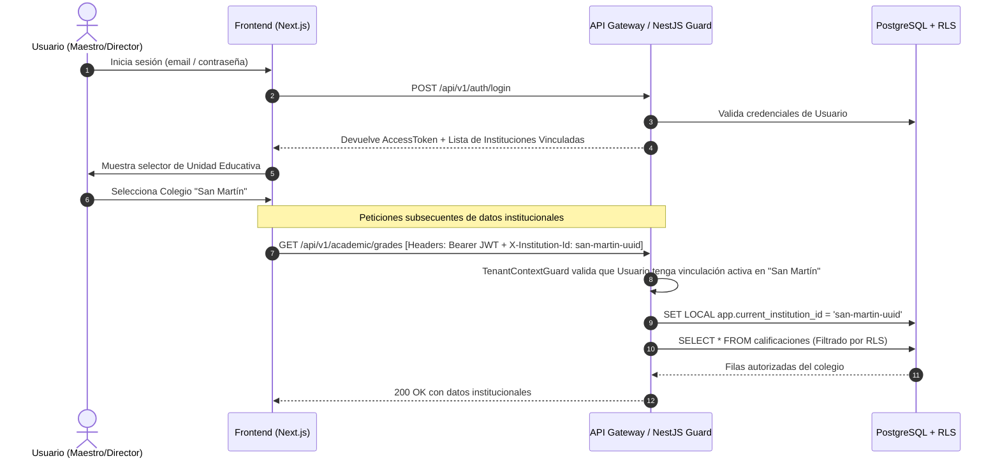

# ADR-002: Arquitectura de Autenticación JWT y Conmutación de Contexto Institucional

- **Estado:** Aprobado
- **Fecha:** 2026-10-31
- **Decisores:** Arquitectura de Software
- **Contexto:** Decisión Pendiente 2 de la Constitución V1.1.0 (Sección 10)

---

## 1. Contexto y Problema

De acuerdo con la **Decisión Estratégica 004** y el **Principio de Identidad Única**, una `Persona` posee una sola cuenta de `Usuario` y un único perfil de `Maestro`, pero puede estar vinculada simultáneamente a múltiples `Unidades Educativas` con roles distintos (ejemplo: Director en la Unidad Educativa "San Martín" y Maestro de Física en la Unidad Educativa "Bolívar").

Se debe definir el mecanismo para:
1. Autenticar de forma segura la identidad del usuario.
2. Determinar la lista de colegios donde el usuario tiene vinculación activa.
3. Establecer y conmutar el contexto institucional activo de forma ágil sin obligar al usuario a cerrar e iniciar sesión nuevamente.
4. Evitar que el frontend falsifique el `institution_id`.

---

## 2. Opciones Consideradas

### Opción A: Token JWT con Institución en el Payload
El token de acceso almacena:
```json
{
  "sub": "user-uuid",
  "email": "maestro@minedu.bo",
  "active_institution_id": "school-a-uuid",
  "active_role": "MAESTRO"
}
```
*Inconveniente:* Cada vez que el docente cambia de colegio en el selector del frontend, se requiere llamar a un endpoint para revocar y reemitir un nuevo Access Token.

### Opción B: Token de Identidad Global + Header `X-Institution-Id` validado en Guard
1. El JWT acredita únicamente la **Identidad Global** (`sub`, `email`, `persona_id`).
2. El usuario consulta sus instituciones autorizadas vía `GET /api/v1/auth/me/institutions`.
3. El frontend almacena localmente el `currentInstitutionId` seleccionado y lo envía en cada petición en el encabezado HTTP:
   `X-Institution-Id: <uuid>`
4. Un guard en NestJS (`TenantContextGuard`) intercepta la petición, verifica en caché/BD que el usuario efectivamente tenga una `VinculaciónInstitucional` activa con dicho colegio, carga sus roles en esa institución y fija el contexto en la sesión de ejecución.

---

## 3. Decisión Adoptada

Se adopta la **Opción B (Token de Identidad Global + Header `X-Institution-Id` validado en NestJS Guard)**.

### Flujo de Funcionamiento:



---

## 4. Consecuencias y Seguridad

1. **Conmutación Instantánea:** El usuario puede cambiar de colegio en la interfaz con un solo clic sin reautenticación ni refresco de tokens.
2. **Defensa contra Manipulación:** Si un usuario altera maliciosamente el valor del encabezado `X-Institution-Id` enviando el UUID de un colegio ajeno, el `TenantContextGuard` rechaza la petición de inmediato con un error `403 Forbidden: No tiene vinculación activa con la institución solicitada`.
3. **Auditoría Transparente:** Cada llamada registra automáticamente la tupla `(user_id, institution_id)` en los logs de auditoría.
